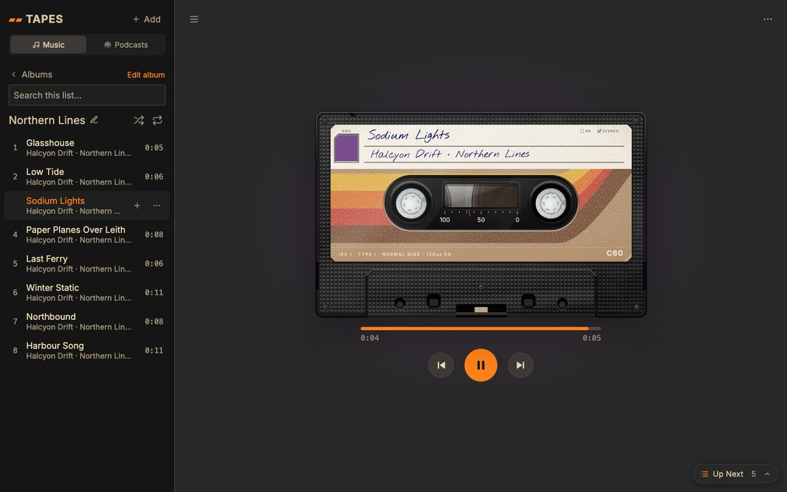
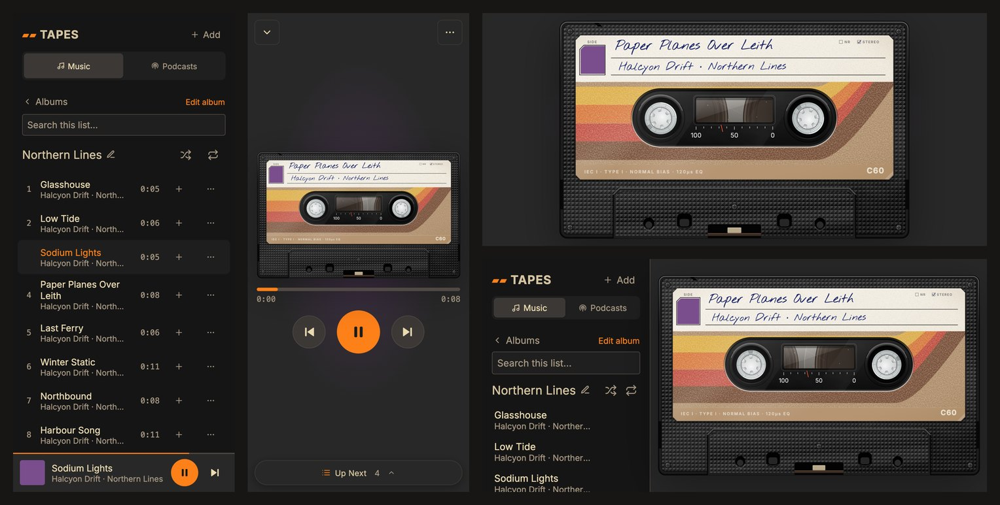
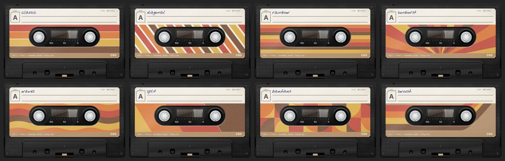

# Tapes

A personal music streamer for the home stack, made for the phone and built around a cassette: each album or tape gets its own printed retro label with the song written on it in ballpoint, the reels wind as it plays and a VU needle follows the music.



## On your phone

Installed from the browser it behaves like an app: the mini player keeps what's playing in reach, the deck has just previous, play and next (its ⋯ holds two settings), and back closes whatever's open. Turn the phone on its side, or tap the tape, and the cassette fills the screen with no buttons at all; a swipe down slides the library out beside it.



In full screen the tape is the control:

| Gesture | Does |
|---|---|
| Tap the left or right side | Previous or next song |
| Tap the middle | Play or pause |
| Double-tap a side | Back or forward 10 seconds |
| Press and hold a side | Rewind or fast-forward while held |
| Swipe down | The library slides out beside the tape (upright: back to the deck) |
| Shake the phone | Shuffle |

Elsewhere: swipe the mini player up to open the deck, the deck down to close it, and the tape sideways to skip.

## The labels

Eight designs, all in one palette of red, orange, mustard and brown on cream: the classic four bands, diagonal, rainbow, sunburst, waves, split, bauhaus and swoosh. An album (or a tape of yours) always gets the same one, and the cover's colour glows behind the tape.



## Features

- **The deck**: scrubber, shuffle and repeat, an Up Next queue you can reorder (a queued song plays next), lock-screen controls that show the cassette, and your queue resumes across devices. The reels whir on a skip or seek, and a new tape ejects the old one.
- **Keep playing**: when a tape or album runs out, related songs follow (ones you play together, the same artists, your favourites) and the tape turns over to side B. Off in the deck's ⋯ menu.
- **Gapless and levelled**: songs join without a gap (each MP3's encoder delay and padding are trimmed, on one continuous stream), and every song plays at the same loudness: EBU R128, with album gain when an album plays in order and a clip-safe ceiling. Levelling can be turned off in the deck's ⋯ menu.
- **Your library**: All Tracks (sortable), Singles, Albums, Artists, your own tapes, and search across everything.
- **Rip** any link to MP3 with `yt-dlp` and `ffmpeg`; a playlist link becomes a new tape. Duplicates are caught by URL and by acoustic fingerprint.
- **Tidy tags**: titles and artists are cleaned on rip and refined by Claude (Haiku) when a key is set. Rips from an album playlist (the artist's own, a "Full Album" upload, or a YouTube Music album) get the album, track number and year. Cover art comes from MusicBrainz when there's a confident match.
- **Podcasts**: follow RSS feeds or YouTube channels; episodes stream while they download, with skips, speed and resume.
- **Safe edits**: deletes go to a 30-day trash with Undo; artist renames show any merge first.
- **Installable**, and works offline once loaded.

## Run it

```sh
uv sync
export MUSIC_DIR=/path/to/mp3s                  # optional; defaults to ./music
uv run flask --app app:create_app db upgrade
uv run flask --app app:create_app scan          # index the library
uv run flask --app app:create_app run --port 5003   # http://127.0.0.1:5003
```

Ripping needs `ffmpeg` on your `PATH`, and duplicate detection needs `fpcalc` (Debian: `libchromaprint-tools`). Standalone mode has no sign-in: a local user is attached automatically. For demo tracks, run `uv run python scripts/generate_samples.py`.

Tests and lint: `uv run pytest` and `uv run ruff check .`

### Settings

| Variable | Does |
|---|---|
| `MUSIC_DIR` | Where the MP3s live |
| `ANTHROPIC_API_KEY` | Turns on the Claude tag pass (optional) |
| `LLM_CLEANING`, `ART_LOOKUP`, `FINGERPRINT_DEDUP` | Set to `0` to turn a pass off |
| `MUSICBRAINZ_CONTACT` | Your email or URL, for MusicBrainz's user-agent policy |
| `TAPES_ADMINS` | Usernames allowed to delete songs and rename artists library-wide |
| `AUDIO_ANALYSIS` | Set to `0` to stop measuring loudness and gapless info (on rip, and slowly in the background) |

## Home stack

Served at `/music/` behind the [dashboard](../dashboard)'s nginx, which signs people in and serves the audio itself (`X-Accel-Redirect`). On the Pi, set `MUSIC_HOST_DIR` to the library's location. After adding a user in the dashboard, run `uv run python scripts/sync_household_users.py` there.

Commits merged to `main` that pass CI deploy to the Pi on their own (see the dashboard README). The container applies database migrations when it starts.

To install it on a phone, open it at the Pi's Tailscale HTTPS address, `https://raspberrypi.tail4dd650.ts.net:8443/music/` (`tailscale serve`, with a real certificate; the self-signed one on the LAN address can't install apps), sign in, and choose Install from Chrome's menu.

## Commands

```sh
uv run flask --app app:create_app scan [--full] [--prune]   # index MUSIC_DIR
uv run flask --app app:create_app retag [--write] [--llm] [--pending]   # clean tags
uv run flask --app app:create_app art [--write] [--all]     # cover art from MusicBrainz
uv run flask --app app:create_app fingerprint [--all]       # backfill fingerprints
uv run flask --app app:create_app analyze [--all] [--no-tags]   # loudness + gapless info (also runs in the background)
uv run flask --app app:create_app purge-trash [--days 30]   # empty the trash
uv run flask --app app:create_app db migrate -m "what changed"   # after editing models.py
```

`retag` and `art` only preview until you add `--write`. `uv run python scripts/eval_metadata.py [--llm]` scores the cleanup against ~670 real YouTube titles and playlists in `tests/fixtures`. `retag --llm` uses the Message Batches API (about half price, can take up to an hour); `retag --llm --pending` sweeps up rips whose Claude pass was skipped.

`analyze` writes standard ReplayGain tags into each file (tags only; the audio is untouched), so other players get the same levelling.

Rips are filed as `MUSIC_DIR/Artist/Album/NN Title.mp3`. Deleted songs wait in `MUSIC_DIR/.trash/` for 30 days.
