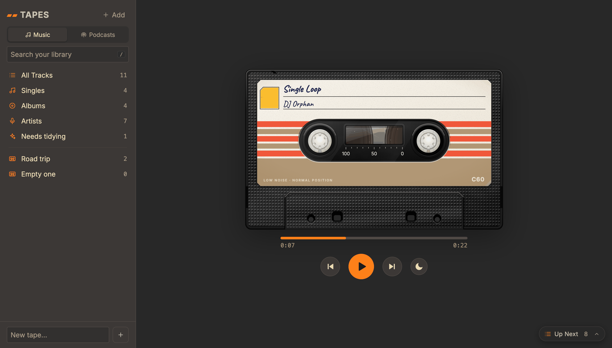

# Tapes

A personal cassette-deck music streamer for the home stack. The home page is a
cassette deck — the reels spin while a track plays and the paper label re-skins
to the current song.



## Features

- **Cassette-deck player** — animated reels, scrubber, shuffle / repeat,
  keyboard shortcuts (`Space`, `←/→` seek, `Shift + ←/→` skip, `↑/↓` volume,
  `M` `S` `R` `Q`, `/` search, `?` for the list), lock-screen controls,
  and it resumes your queue across sessions and devices.
- **Browse** — All Tracks (sortable: by artist / recently added / recently
  played / most played; the sort is remembered per shelf), Singles, Albums,
  Artists, and your own tapes. Search your whole library from the shelf.
- **Installable** — add it to your home screen; the app and your lists open
  offline, and a song cut off by a dropped connection resumes where it was.
- **Up Next** queue with drag-to-reorder; *Play next* / *Add to queue* per track.
- **Rip** any URL to MP3 with cover art via `yt-dlp` + `ffmpeg`, with live
  progress over SSE; paste a YouTube playlist to rip it into a new tape. The
  original source URL is saved with each track. Re-ripping a URL you already have
  is skipped, and acoustic fingerprinting (Chromaprint) catches the same
  recording even from a different URL — adding it to your tape without making a
  duplicate.
- **Tidy metadata** — ripped tags are cleaned automatically (YouTube cruft
  stripped, `Artist - Title` split). With `ANTHROPIC_API_KEY` set, a Claude
  (Haiku) pass then refines title/artist and fills in a blank album when it's
  confident — using the source URL, channel/uploader, and yt-dlp's own parsed
  fields as signals; without a key it falls back to the deterministic cleanup.
- **Cover art** — on rip, the weak YouTube thumbnail is replaced with real album
  art from **MusicBrainz** + the Cover Art Archive when a confident artist/album
  match exists. `flask art` backfills the library.
  `flask retag` re-cleans an existing library (`--llm` to use Claude in bulk).

## Run it — standalone

```sh
uv sync
export MUSIC_DIR=/path/to/mp3s            # optional; defaults to ./music
uv run flask --app app:create_app db upgrade   # create / update the database
uv run flask --app app:create_app scan    # index the library
uv run flask --app app:create_app run --port 5003
# open http://127.0.0.1:5003
```

`ffmpeg` must be on your `PATH` for ripping, and `fpcalc` (Debian
`libchromaprint-tools`) for the acoustic dedup. Set `ANTHROPIC_API_KEY` to
enable the LLM tag pass (optional — rips work without it). `LLM_CLEANING=0` /
`ART_LOOKUP=0` / `FINGERPRINT_DEDUP=0` turn off each pass.
There's no login in standalone mode
— a single local user is attached automatically. To try it without your own
music, `uv run python scripts/generate_samples.py` writes tagged demo tracks
into `./music`.

## Run it — home stack

Served at `/music/` behind the [dashboard](../dashboard) nginx proxy: gated by
its `auth_request` and streaming audio via `X-Accel-Redirect`. The service is
wired into `../dashboard/docker-compose.yml` (internal port `5003`).

```sh
cd ../dashboard
MUSIC_HOST_DIR=/mnt/backup/music docker compose up -d --build music
```

Dashboard handles login; tapes trusts the `X-Forwarded-User` header and keeps
its own `users` rows for tapes and playback state.

After adding a user in dashboard, sync shadow accounts:

```sh
cd ../dashboard && uv run python scripts/sync_household_users.py
```

> On the Pi, merged commits that pass CI deploy themselves within about five
> minutes (see the dashboard README, "Deploying"). To deploy by hand: code is
> baked into the image at build time, so after pulling run
> `docker compose build music && docker compose up -d music`. A bare `up -d`
> reuses the old image.
>
> The container applies database migrations itself on start (a gunicorn hook,
> before any worker runs); if one fails, it stops instead of serving on a
> half-updated schema. A database from before migrations is brought up to date
> by the first one, with nothing to run by hand.

## Commands

```sh
uv run flask --app app:create_app purge-trash [--days 30]               # empty the library trash
uv run flask --app app:create_app scan [--full] [--prune]   # index MUSIC_DIR
uv run flask --app app:create_app retag [--write] [--llm] [--pending]  # clean (and enrich) tags
uv run flask --app app:create_app art [--write] [--all]     # fetch cover art (MusicBrainz)
uv run flask --app app:create_app fingerprint [--all]       # backfill acoustic fingerprints
uv run flask --app app:create_app db upgrade                # apply database migrations
```

Changing the schema: edit `models.py`, then
`uv run flask --app app:create_app db migrate -m "what changed"`, review the
file it writes under `migrations/versions/`, and commit it.

Rips are filed as `MUSIC_DIR/Artist/Album/NN Title.mp3` (or `Artist/Title.mp3`
without an album) once their tags are cleaned; same-named rips get " (2)".
While a rip runs it works in `MUSIC_DIR/.incoming/<job>/`, which scans skip.
Songs you add by hand can live anywhere under `MUSIC_DIR`.

Deleting a song moves it to `MUSIC_DIR/.trash/` (with an Undo toast); it's
removed for good after 30 days, on the next delete or via `purge-trash`. Set
`TAPES_ADMINS` (comma-separated usernames) to limit deleting and library-wide
artist renames to those users.

`scan` is incremental (mtime/size cache); `--full` re-reads every file, `--prune`
drops rows for deleted files. `art` looks up cover art on MusicBrainz for tracks
with a known artist + album (preview by default; `--write` embeds it, `--all`
also upgrades tracks that already have a thumbnail) — throttled to ~1 lookup/sec
per MusicBrainz policy. `retag` previews by default; `--write` applies the
cleanup in place and rescans. `--llm` routes the (already deterministically
cleaned) tags through Claude via the **Message Batches API** to correct
title/artist and fill in a blank album — needs `ANTHROPIC_API_KEY`, costs ~half
the standard rate, and takes up to ~an hour for a large library. Enrichment only
fills an empty album; it never overwrites existing tags. If the LLM pass is
skipped on a rip (no key / API error) the track is flagged `needs_llm`;
`retag --llm --pending` sweeps up just those misses in one batch and clears the
flag — handy to schedule, or to run after topping up credit.

## Layout

```
app.py          create_app: db, login, blueprints, static cache-busting
cleaning.py     deterministic title/artist cleanup for rips
llm_cleaning.py Claude (Haiku) tag correction + album fill; sync per-rip, Batches for retag
art.py          MusicBrainz + Cover Art Archive lookup
fingerprint.py  Chromaprint acoustic fingerprint + local match for content dedup
scan.py         flask scan / flask retag — mutagen tags + Pillow thumbnails
downloader.py   yt-dlp worker, playlist expansion, tag cleanup
routes/         index · stream · library (shelves/tapes/albums/artists) · downloads · auth
static/         css (tokens · primitives · index · player) + player.js
templates/      index.html
```
